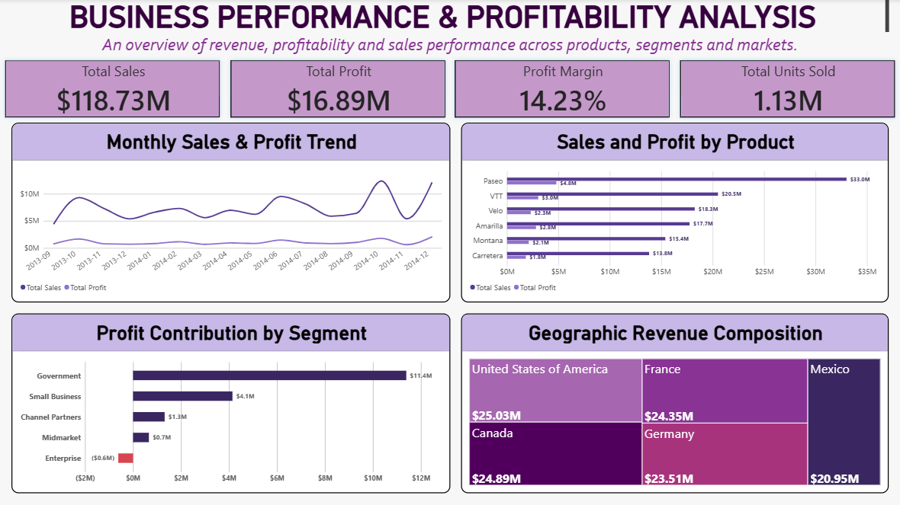

# Power BI Sales & Profitability Dashboard

An interactive Microsoft Power BI dashboard for analysing sales performance, profitability, product performance, segment contribution, and geographic revenue.

## Dashboard Preview



## Key Insights

The dashboard presents four headline performance indicators:

| KPI | Description |
|---|---|
| Total Sales | Overall revenue generated |
| Total Profit | Overall profit generated |
| Profit Margin | Profit as a percentage of sales |
| Units Sold | Total quantity of products sold |

The analysis also highlights the following observations:

- **Product Performance:** Paseo recorded the highest sales and profit among the products analysed.
- **Segment Profitability:** Government was the most profitable customer segment, contributing approximately $11.4 million in profit.
- **Enterprise Segment:** Enterprise recorded a negative profit of approximately $0.6 million.
- **Geographic Performance:** Revenue distribution across countries provides a comparative view of geographical sales contribution.

## Project Structure

```text
powerbi-sales-profitability-dashboard/
|-- assets/
|   -- dashboard.png
|-- dataset/
|   -- README.md
|-- report/
|   -- Business_Performance_Analysis.pbix
|-- README.md
```

## Dataset

This project uses Microsoft's **Financial Sample** dataset. The source data is not redistributed in this repository.

- Dataset: Financial Sample
- Provider: Microsoft
- Official source: [Power BI sample datasets](https://learn.microsoft.com/en-us/power-bi/create-reports/sample-datasets)
- Dataset setup: [dataset/README.md](dataset/README.md)

## Tools

- Microsoft Power BI Desktop
- Power Query
- DAX (Data Analysis Expressions)

## Open the Report

1. Install Microsoft Power BI Desktop.
2. Download or clone this repository.
3. Open [Business_Performance_Analysis report](report/Business_Performance_Analysis.pbix).
4. If Power BI asks to locate or refresh the data source, download the Financial Sample dataset from Microsoft's official source and reconnect it using the instructions in [dataset/README.md](dataset/README.md).

## Purpose

This project demonstrates dashboard design, DAX calculations, data modelling, and business reporting in Power BI.